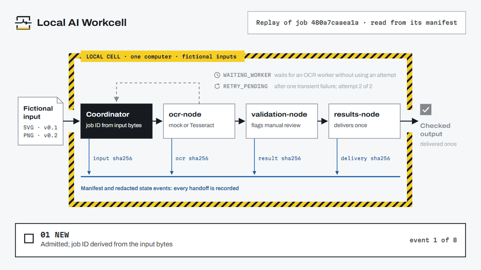
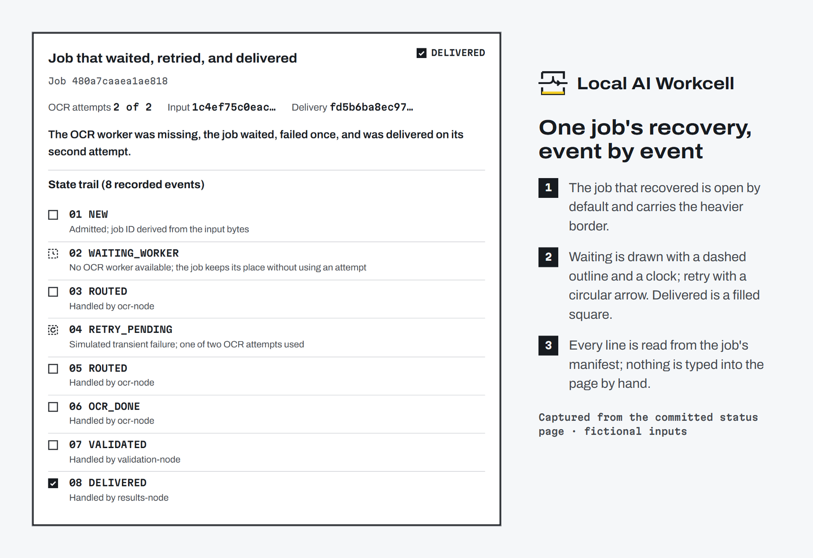
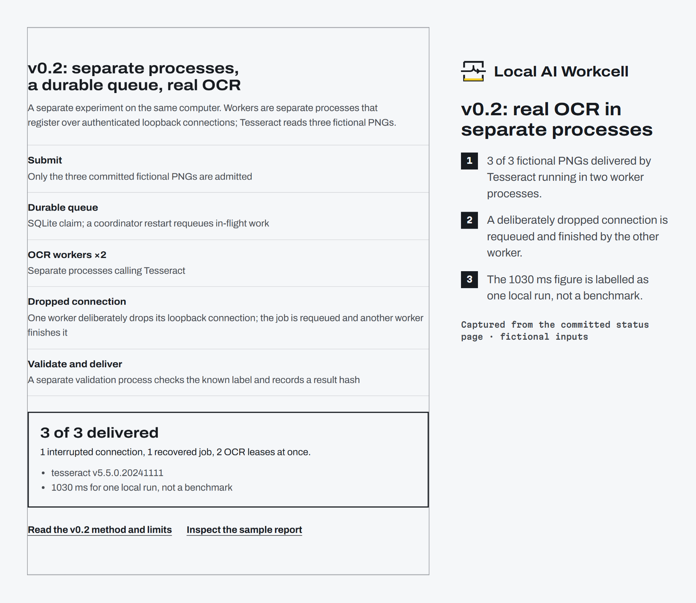
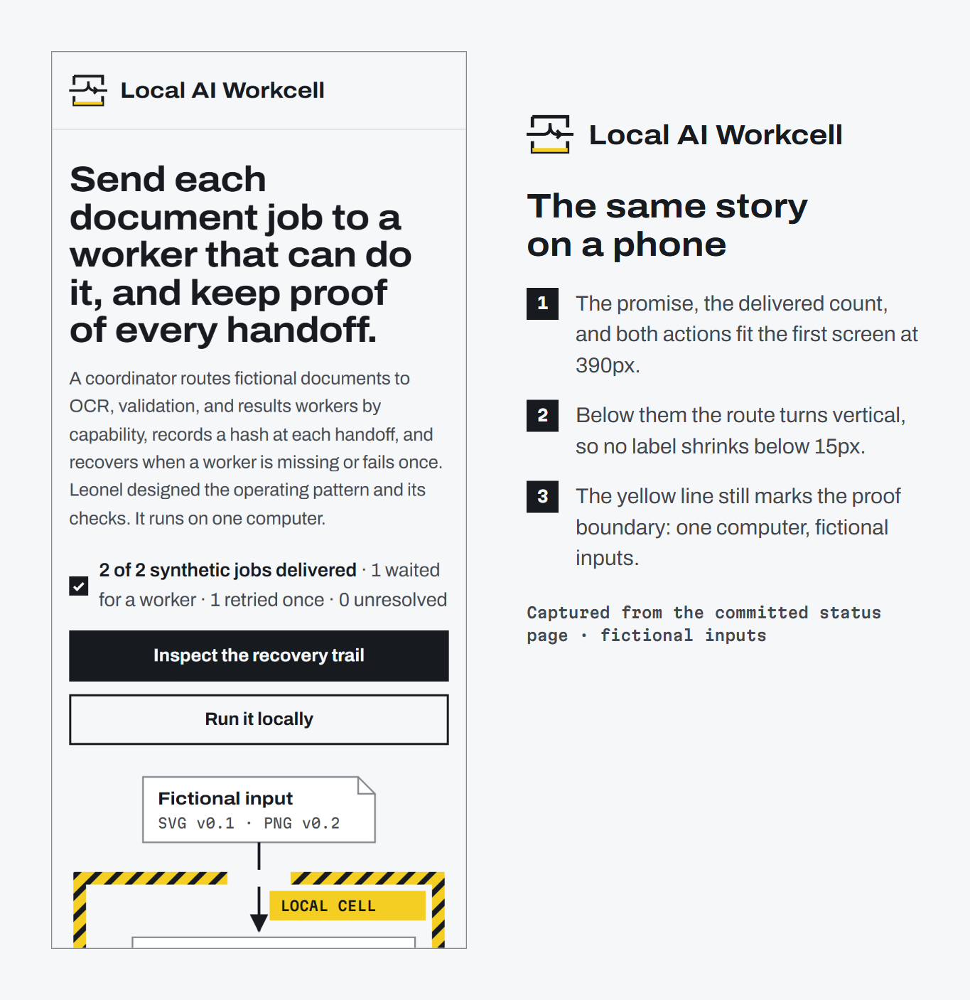

<picture>
  <source media="(prefers-color-scheme: dark)" srcset="docs/brand/hero-dark.png">
  
</picture>

**[Open the live walkthrough](https://leonelivancortesrodriguez.github.io/local-ai-workcell/)** · [Run it locally](#run-it-locally) · [v0.2 process proof](docs/V2_PROOF.md) · [Español](README.es.md)

[](https://github.com/LeonelIvanCortesRodriguez/local-ai-workcell/actions/workflows/verify.yml)

A small local system that sends each document job to a worker that can do it, records every handoff, and recovers when a worker drops out. It is a public, synthetic proof: one computer, fictional inputs, and tests anyone can rerun.

## The problem

When AI work is split between workers with different abilities (one runs OCR, another validates, another delivers), jobs get lost between them. The operator can't easily say where a job is, whether it finished, what changed it, or how to resume it. A result without a reliable handoff record is hard to trust. This repository shows that control pattern on one computer.

## See it recover

<picture>
  <source media="(prefers-reduced-motion: reduce)" srcset="docs/brand/replay-poster.png">
  
</picture>

One job from the committed fixtures, replayed from its manifest: it waits for a missing OCR worker without spending an attempt, fails once, is routed again, and is delivered on its second and final attempt. The other job goes straight through. [MP4 version](docs/brand/replay.mp4).

## How the workflow runs

1. **Controlled input.** Only fictional fixtures are admitted: two SVGs for v0.1, three PNGs for v0.2. The job ID derives from the input bytes and pipeline version, so a duplicate submission returns the existing job.
2. **Coordinator.** Routes by capability label (`ocr-node`, `validation-node`, `results-node`), never by hostname. In this demo the coordinator and every worker share one Python process.
3. **OCR.** v0.1 uses a mock that reads SVG text nodes; it recognizes no pixels. v0.2 calls Tesseract from separate worker processes.
4. **Validation.** Keeps source hashes, derived counts, and a required manual-review flag in separate fields. Mock OCR says nothing about accuracy, so manual review stays required.
5. **Checked output.** Delivered once, with an output checksum.
6. **Recovery.** A missing worker puts the job in `WAITING_WORKER`, where it keeps its place without using an attempt. A transient failure moves it to `RETRY_PENDING`; the second attempt either succeeds or ends at `FAILED`.

Every station records a hash in the manifest. State events are redacted: they hold state, phase, generic worker label, and reason code, but no document text or local path. See the [architecture and state map](docs/ARCHITECTURE.md).

## Result and evidence

| Status | What it covers | Where to check |
| --- | --- | --- |
| Implemented and tested | v0.1: deterministic IDs, capability routing, legal state changes, waiting, bounded retry, duplicate protection, checksums, delivery | `python -m unittest`, [`tests/test_workcell.py`](tests/test_workcell.py) |
| Implemented and tested | v0.2: three local worker processes, authenticated loopback registration, rejection of an invalid key, durable SQLite queue, restart recovery, a deliberate connection drop, Tesseract on three fixed images | `WORKCELL_V2_INTEGRATION=1` tests, [`tests/test_v2.py`](tests/test_v2.py) |
| Observed once | 3 of 3 PNGs delivered, 1 interrupted connection recovered, 2 simultaneous OCR leases, 1030 ms elapsed (Python 3.14.5, Tesseract 5.5.0, 2026-10-26). One run, not a benchmark | [`docs/v2-sample-report.json`](docs/v2-sample-report.json) |
| Owner-reported, not verified here | Leonel reports using a similar pattern in private work that spans more than one computer. Nothing in this repository shows, runs, or tests that | No public evidence |
| Planned | Remote worker transport, real network partitions, broader OCR corpora, GPU contention control | [Berth](https://github.com/T-Crypt/berth) is a source-reviewed candidate only |

A mutation check changes a delivered v0.1 result and requires checksum verification to reject it.

## Product views







## Leonel's role and decisions

**Problem chosen.** Show, on one computer and with fictional inputs, how a coordinator can route document jobs by capability and keep a checkable record of every handoff and recovery.

**Role.** Leonel made the operating decisions, set the public proof scope and fictional fixtures, chose the failure cases, and wrote the acceptance checks. Coding agents helped implement the source, the status page, and the tests.

**Decisions that shape the system**

- *Route by capability, not by host.* Workers are named for what they can do (`ocr-node`, `validation-node`, `results-node`), so a job's route depends on the capability it needs. Remote workers are planned, not built.
- *Waiting is not failure.* A missing worker costs no attempt; the job keeps its place.
- *Bounded retry.* Two OCR attempts, then `FAILED`, so nothing loops.
- *Hash every handoff.* Input, OCR, result, and delivery hashes make a changed result detectable.
- *Keep manual review on.* The result says when its evidence can't support an accuracy claim.

**Constraints.** Public and reproducible; no private documents, hostnames, credentials, or logs; Python standard library at runtime; no paid service.

**Observed results.** All 16 tests pass with integration enabled. The sample v0.2 run delivered 3 of 3 fictional PNGs and recovered the deliberate disconnect.

**Technologies.** Python 3.11 to 3.14 (standard library), SQLite, `multiprocessing.connection` with authenticated loopback, Tesseract (optional, not bundled), GitHub Actions, and a generated static HTML status page.

## Limitations

One computer. Fictional inputs. No remote node, TLS, distributed consensus, production credential store, arbitrary upload, or private document. The connection drop is deliberate and local; it does not prove recovery from a real network partition. Nothing here establishes general OCR accuracy, multi-computer reliability, production security, or operational outcomes. The privacy scan is a bounded detector, so the public package still needs human review.

## Run it locally

The v0.1 walkthrough needs Python 3.11 or newer and nothing else.

```bash
python -m workcell.cli demo --output out
python -m workcell.cli verify --output out
```

Open `out/index.html`. The output directory must be absent or empty. The committed [`index.html`](index.html) is the same synthetic run; refresh it with `python scripts/refresh_demo.py`.

For v0.2, install Tesseract from its official package, then:

```bash
python -m workcell.v2 demo --output out-v2
```

It prints delivered, interruption, recovery, concurrent-lease, and elapsed observations, writes `out-v2/report.json`, and leaves `out-v2/queue.sqlite3` for inspection. See [v0.2 proof and limits](docs/V2_PROOF.md).

### Verify

```bash
python -m unittest discover -s tests -v      # set WORKCELL_V2_INTEGRATION=1 for socket and OCR tests
python tests/mutation_check.py
python scripts/privacy_scan.py
python scripts/contrast_check.py
python scripts/package.py --output release
```

The [workflow](.github/workflows/verify.yml) runs these on Python 3.11 to 3.14, regenerates the status page, runs both demos, and builds the package twice to confirm it is deterministic. The badge shows GitHub's actual CI state; a local pass is not a CI pass. The [release procedure](docs/RELEASE.md) covers the `v0.2.0` tag, ZIP, inventory, and rollback.

## Privacy, assets, and license

Every SVG and PNG fixture is fictional and was made for this repository. No private document, real node identity, credential, operational log, or personal screenshot is included. Read [SECURITY.md](SECURITY.md).

The README and social images are rendered from the same diagram code as the status page (`python design/compose.py`, then `node design/render.mjs`; see [design/README.md](design/README.md)). Owner-authored code, documentation, fixtures, and images are under the [MIT License](LICENSE). Archivo and Martian Mono are bundled under the SIL Open Font License; see [third-party notices](THIRD_PARTY_NOTICES.md).
