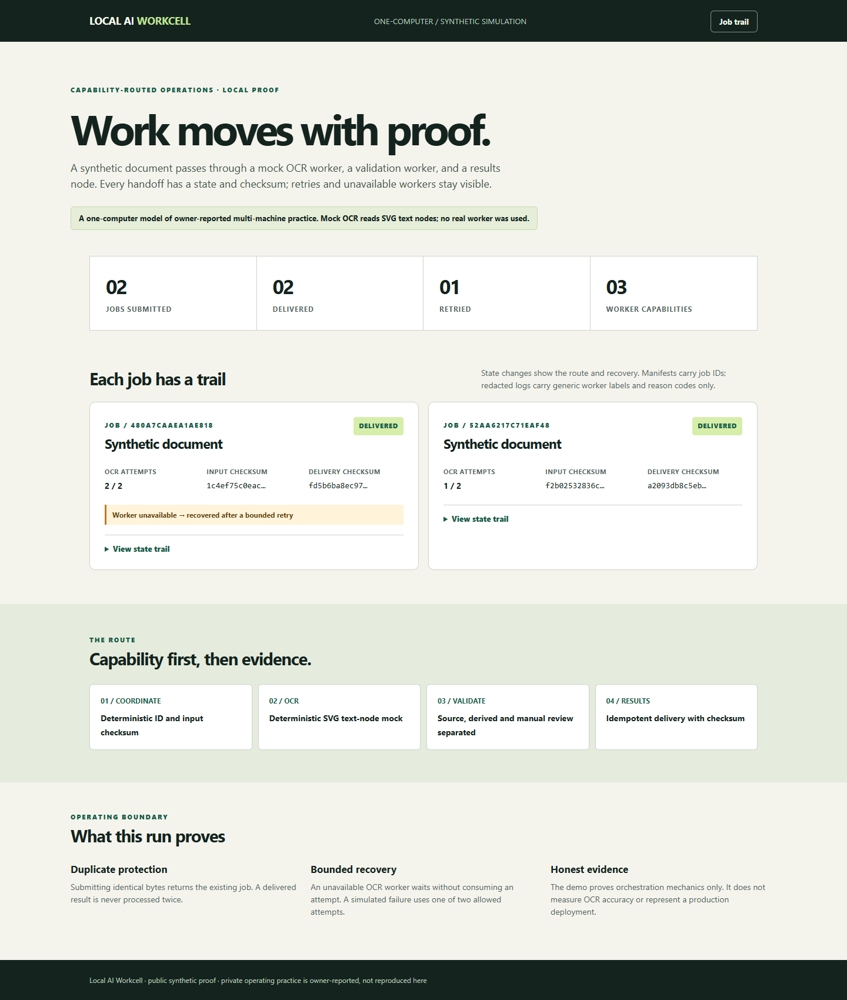

# Local AI Workcell

A safe public base for a real operating idea: route tasks by capability, preserve evidence at each handoff, and deliver a validated result. The owner reports using a living multi-machine workflow for remote tasks, capability-specific OCR, result transfer, Git coordination, and Docker-dependent work. This repository demonstrates selected controls on one computer with synthetic SVG documents and deterministic mock OCR. It is not a reproduction of the private system.



## The operating problem

When machines have different capabilities, the operator needs to know where a job went, whether it finished, what changed, and how to recover it. A result without a reliable handoff is hard to trust. The coordinator is a movable control role, not a fixed physical machine. This demonstration turns the control pattern into a small, inspectable workflow.

The project owner designed and operates the private workflow and defined this public demonstration's privacy boundary, acceptance checks, and case-study direction. Coding agents helped implement the synthetic demonstration and tests. The private configuration, documents, and operational records are not part of this repository.

## Evidence map

| Category | What is stated or shown | Evidence boundary |
| --- | --- | --- |
| Owner-reported operating practice | A living multi-machine workflow supports remote tasks, capability-specific OCR, result transfer, Git coordination, and Docker-dependent work. Coordinator control can move between machines. | This is the owner's account of private practice. The public repository does not independently verify its topology, reliability, or outcomes. |
| Publicly reproducible proof | One local Python process routes two fictional SVG jobs through mock OCR, validation, and results roles. Tests exercise identity, waiting, retry, duplicate protection, checksum checks, and delivery. | Run the commands below and inspect the synthetic manifests, results, and status view. |
| Experiments and roadmap | Synthetic multi-process or Docker routing, authenticated worker transport, real OCR evaluation on an approved public corpus, and distributed failure recovery. | These are proposed experiments, not implemented or claimed as completed. |

## Inspect it in five minutes

Requires Python 3.11 or newer. There are no runtime dependencies or paid services.

```bash
python -m workcell.cli demo --output out
python -m workcell.cli verify --output out
```

Open `out/index.html` in a browser. The committed [static example](index.html) shows the same synthetic run. The first job delivers directly. The second waits for an unavailable OCR worker, then recovers after one simulated transient failure. Both have deterministic IDs, bounded attempts, checksums, and redacted state trails.

The output directory must be absent or empty. Delete your own `out/` directory before rerunning the demo. To refresh the committed static view from the fixtures, run `python scripts/refresh_demo.py`.

## What the workflow does

1. A movable coordinator role accepts only synthetic SVG fixtures beginning with `SYNTHETIC DEMO`. In this demo it runs in the same Python process as every worker. The job ID derives from the document bytes and pipeline version.
2. Capability routing selects generic `ocr-node`, `validation-node`, and `results-node` labels. No hostname or remote connection is involved.
3. The OCR stage reads SVG text nodes as a **mock**. It does not recognize pixels, PDFs, or handwriting.
4. Validation produces a result that separates source checksums, derived counts, and a required manual-review flag.
5. The results stage delivers once, checks for conflicts, and records an output checksum. Duplicate submission returns the existing job without another delivery.

See the [architecture and state map](docs/ARCHITECTURE.md) for the recovery path and manifest schema.

## Verify the controls

```bash
python -m unittest discover -s tests -v
python tests/mutation_check.py
python scripts/privacy_scan.py
python scripts/package.py --output release
```

The mutation test changes a delivered result in a temporary synthetic run and requires checksum verification to reject it. The package command creates a deterministic allowlisted ZIP and SHA-256 inventory. The privacy scan is a bounded detector; independent review of the candidate inventory remains necessary.

## Evidence and privacy boundary

The repository proves orchestration behavior in a local simulation: deterministic identity, capability routing, legal state changes, bounded retry, waiting and recovery, duplicate protection, checksum validation, and a status view. It does **not** prove OCR accuracy, multi-computer reliability, production security, or quantified operational outcomes. The retained event log contains state, phase, generic worker label, and reason code. It contains no job ID, document text, or local path; the job ID is in the manifest and its parent directory.

The two SVG documents are fictional and were created for this release. No private document, network identity, credential, real log, or personal screenshot is included. Read [SECURITY.md](SECURITY.md) and [THIRD_PARTY_NOTICES.md](THIRD_PARTY_NOTICES.md).

## License

Owner-authored source, documentation, fixtures, and status-view images are released under the [MIT License](LICENSE). See [third-party notices](THIRD_PARTY_NOTICES.md) for development tools used to capture screenshots.
