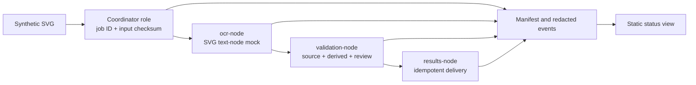

# Architecture and state map

The public demonstration runs all roles in one Python process. The coordinator is a movable control role in the owner's reported private practice; the diagram places that role in the local process for this synthetic run. Node names describe capabilities, not actual machines or network endpoints.

## State path

`NEW → ROUTED → OCR_DONE → VALIDATED → DELIVERED` is the normal path. If the needed worker is unavailable, the job enters `WAITING_WORKER` without using an OCR attempt; making that capability available lets it resume at the saved phase. A simulated OCR failure enters `RETRY_PENDING` after the first attempt. The second attempt either succeeds or ends at `FAILED`. Delivered and failed jobs are terminal.

The manifest records a deterministic ID, pipeline version, phase, state, attempts, input/OCR/result/delivery hashes, mock-OCR label, and ordered events. The separate `events.jsonl` contains only job ID-free state metadata and generic worker labels; the job ID appears in its parent folder and manifest. The status page shows state, attempts, truncated checksums, and event codes. It does not display input text.

The results JSON keeps `source` hashes, `derived` counts, and `manual_review` status in separate fields. The manual-review flag remains required because reading SVG text nodes provides no evidence of real OCR accuracy.

## Limitations

The owner reports a living private multi-machine workflow for remote tasks, capability-specific OCR, result transfer, Git coordination, and Docker-dependent work. This diagram does not depict or verify that private topology. The public simulation does not schedule distributed tasks, authenticate workers, encrypt traffic, process scans or PDFs, or claim fault tolerance across real machines. Docker is unnecessary for this bounded single-computer proof. Future experiments could test synthetic distribution and Docker routing, authenticated transport, public-corpus OCR, and distributed recovery.
